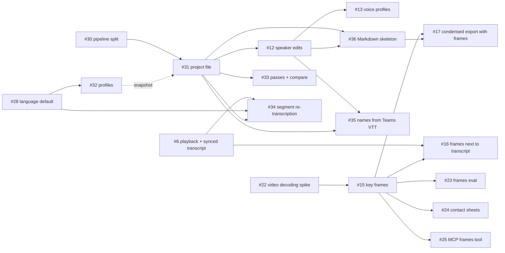

# Implementation roadmap

Recommended order for the open issues (state 2026-11-13). Milestones group features by theme; this file says what
to build first. Done so far: M0 (library, CLI, eval), MCP server (#10), desktop scaffold (#4) and the run with
progress (#5).

Rules behind the order:

1. Unblock first: the pipeline split (#30) and the project file (#31) block most of M1.5 and M2, so they come
   before UI work that would otherwise be built twice (speaker edits stored in JSON, then moved to SQLite).
2. Decide before building on it: the language default (#28) shapes the profile format (#32) and segment
   re-transcription (#34); the video decoding spike (#22) gates all of M3.
3. Finish the M1 shell early but keep it thin: playback (#6) is needed by #34 and #16, the rest is small.
4. Quality fixes that only touch ASR (#29) or memory (#11) can run in parallel with anything.

## Dependencies

## Phases

### Phase 1: usable desktop app (M1) + cheap quality wins

| Order | Issue | Why now |
|---|---|---|
| 1 | #6 Playback with synced transcript, click-to-seek | Core of the app; prerequisite for #34 and #16. |
| 2 | #7 Export VTT and JSON | Small, makes the app useful on its own. |
| 3 | #8 First-run model download with progress | Needed before anyone else can run the app. |
| 4 | #9 macOS app bundle with the dylibs | Closes M1; distribution. |
| ∥ | #29 Suppress whisper repetition loops | ASR only, independent; visible quality gain. |
| ∥ | #28 Language default for mixed-language meetings | Measurement + decision; feeds #32 and #34. |
| ∥ | #11 Peak memory of a run | Matters once the app stays open between runs; do before M1.5 adds more state. |

### Phase 2: core foundation (M1.5 part 1)

| Order | Issue | Why now |
|---|---|---|
| 5 | #30 Split the pipeline into steps, word sink, cancellation, word probability | Blocks #31, #33, #34; also gives the app cancel (left optional in #5). |
| 6 | #32 Settings profiles (without the project snapshot) | Independent of #31; useful in CLI and MCP right away. Language field per #28. |
| 7 | #31 One SQLite project file per meeting | Storage for everything after it; includes the profile snapshot from #32. |

### Phase 3: working with a meeting (M1.5 part 2 + M2 core)

| Order | Issue | Why now |
|---|---|---|
| 8 | #12 Rename, merge, split speakers; re-run assembly only | Highest daily value; builds on stored turns/words in #31. Library API first, then UI. |
| 9 | #35 Name speakers from an imported Teams VTT | Small on top of #12; removes most manual renaming for Teams recordings. |
| 10 | #34 Re-transcribe a selected segment | The practical fix for mixed-language meetings (#28); needs #6 and #31. |
| 11 | #33 Extra passes and chunk-by-chunk comparison | Shares the run/selection model with #34; build right after it. |
| 12 | #36 Markdown skeleton for agent analyses (outline, condensed transcript, templates, MCP tools) | Needs names (#12/#35) and reliability data (#33, #34, #29) to be worth it. |

### Phase 4: speaker extras (rest of M2)

| Order | Issue | Why now |
|---|---|---|
| 13 | #14 Keep speakers with little speech | Diarization tuning; manual split from #12 is the workaround until then. |
| 14 | #13 Voice profiles across meetings | Needs stored embeddings (#31) and named speakers (#12); later known speakers in profiles (#32). |

### Phase 5: scenes (M3)

| Order | Issue | Why now |
|---|---|---|
| 15 | #22 Video decoding spike (openh264 vs ffmpeg) | Decision with numbers gates the rest of M3. |
| 16 | #15 Key frames from the video | Port of cml meeting-frames. |
| 17 | #23 `frames eval` against hand-picked moments | Verifies #15 matches the Python tool before building on it. |
| 18 | #25 `frames` tool in the MCP server | Cheap once #15 exists; agents get frames without the app. |
| 19 | #24 Contact sheets of the key frames | Small, output-only. |
| 20 | #16 Key frames next to the transcript | Desktop UI; needs #6. |
| 21 | #17 Condensed export with frames | Extends the #36 template export with frames. |

M3 is independent of phases 2–4 apart from #16 (#6) and #17 (#36). If key frames become more urgent than projects,
#22 → #15 → #25 can run in parallel with phase 2 without conflicts (new `video`/`frames` modules in core).

## Parallel tracks

Work that touches different code and can go to separate worktrees:

- Desktop front-end (#6, #7, #8) vs. core/ASR (#29, #11) vs. evaluation (#28).
- #32 profiles (new config module, CLI/MCP flags) alongside #30 (pipeline internals).
- M3 (#22, #15) alongside anything in phases 2–4.

Not in parallel: #30 and #31 (the schema follows the step API), #33 and #34 (shared run/selection model).
